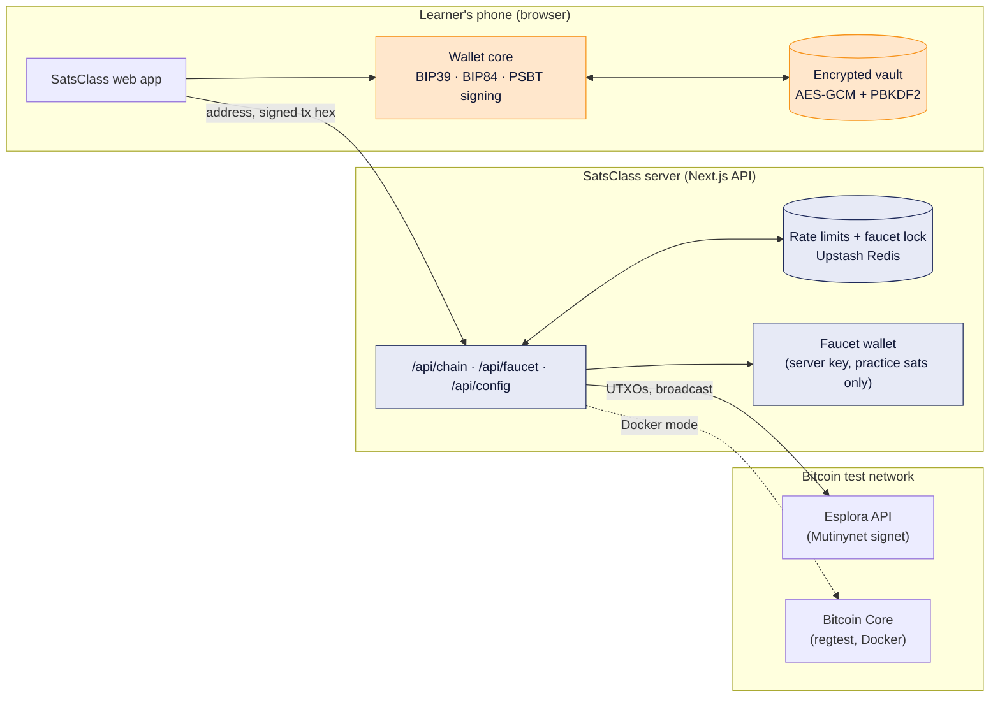
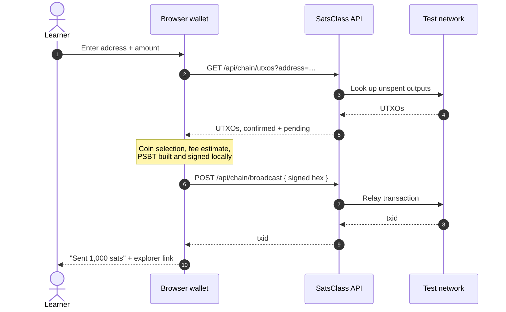
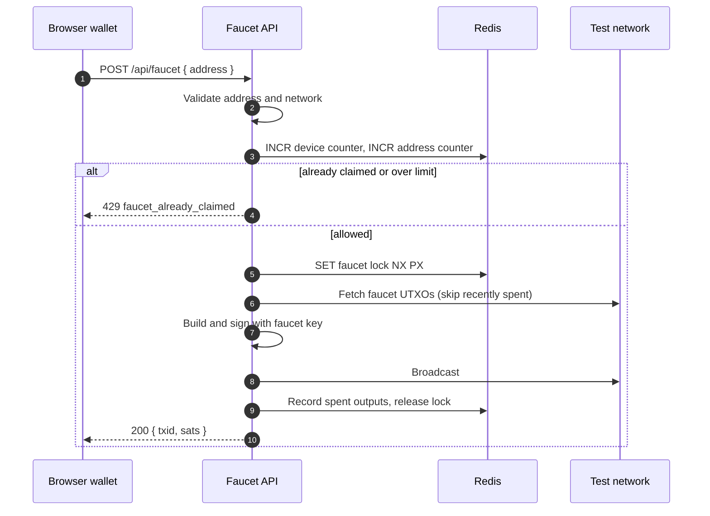

<div align="center">


# SatsClass

**Your first bitcoin, the safe way.**
A real self-custodial wallet on your phone, with practice money, built for Bitcoin classes and meetups.

[](https://github.com/thesithunyein/satsclass/actions/workflows/ci.yml)
[](https://github.com/thesithunyein/satsclass/actions/workflows/integration.yml)
[](https://satsclass.vercel.app)
[](LICENSE)
[](#networks)
[](https://nextjs.org)
[](app/tsconfig.json)
[](https://github.com/bitcoinjs/bitcoinjs-lib)
[](app/src/lib/i18n.ts)

[Live app](https://satsclass.vercel.app) · [How it works](#how-it-works) · [Run it](#run-it) · [Security](SECURITY.md)

</div>

---

## Why

Most people meet Bitcoin through a custodial exchange app. They never hold a key, never back up a seed, never see a fee. When they finally try self-custody with real money, one mistake costs them.

In classrooms it's worse: a teacher can't ask 30 students to risk real sats, so the lesson stays on the whiteboard.

**SatsClass lets everyone do the real thing with practice money.** Each learner gets a self-custodial wallet in the browser, receives sats from the class faucet, backs up a recovery phrase, and sends a real transaction on a test network. Nothing to install, no account, no personal data.

## Features

| | |
|---|---|
| **Self-custody from minute one** | Keys are generated and used only in the browser. The server never sees a seed or a private key. |
| **Practice money** | Runs on signet (Mutinynet) or a private regtest chain. Sats have no value, so mistakes are free. |
| **Class faucet** | One tap gives each learner 10,000 practice sats. One claim per address, rate-limited per device. |
| **Real transactions** | Native SegWit (BIP84). The browser selects coins, signs, and the server only relays the signed hex. |
| **Encrypted on the phone** | The recovery phrase is stored with AES-GCM, keyed from a 6-digit PIN through PBKDF2 (210,000 rounds). |
| **Built for real classrooms** | Mobile-first, works on slow networks, plain words, English and French. |
| **Classroom mode** | A teacher opens `/teach`, students scan one QR code and pick a nickname. Three missions (get sats, back up, send to a classmate) show up live on the teacher's board. |
| **Ask Sats, the AI tutor** | Answers beginner questions in English or French using the learner's own practice transactions (amounts, fees, confirmations). Pasted recovery phrases are blocked before they reach the model. |
| **Real Lightning** | In Docker mode a class LND node opens a channel to a shop LND node on first use. Learners buy a practice café Touba for 1,000 sats and get the payment preimage as their receipt. Only the shop's invoices can be paid, so the class node can't be drained. |
| **One-command setup** | `docker compose up` starts Bitcoin Core, LND, a block miner and the app. |

## Who it's for

**Primary user: a volunteer Bitcoin teacher** running a 1–2 hour session for 20–40 people, often in a school room or meetup with mid-range Android phones and patchy mobile data.
**Secondary user: each learner**, holding self-custody for the first time.

| | Today, without SatsClass | With SatsClass |
|---|---|---|
| Setup | Teacher helps people install a mainnet wallet one by one | Students scan one QR code; a wallet is ready in under a minute |
| Practice | Nobody wants to risk real money, so most never send a transaction | Everyone gets 10,000 practice sats and sends a real transaction |
| Backup | Teacher says "write your words down" and hopes | App checks 3 random words before the mission counts |
| Lightning | Explained on a whiteboard | Everyone pays a real invoice and gets a receipt |
| Follow-up | Teacher can't see who is stuck | Live board shows every student's progress |
| Questions | One teacher, 30 questions | "Ask Sats" answers using each student's own transactions, in English or French |

### Reach (estimate)

Assumptions, not measured yet: one teacher runs **2 sessions a week** with **25 learners** each.

- **50 people per teacher per week** complete their first self-custodial transaction, about 2,600 a year.
- The faucet costs **10,000 practice sats per learner**; a 1,000,000-sat faucet covers ~95 learners and is refilled free from a signet faucet.
- Infrastructure on the free tiers of Vercel and Upstash; AI tutor cost estimated at a fraction of a cent per class on the cheapest models.

### Metrics to track

| Metric | Why | Where it comes from |
|---|---|---|
| Learners onboarded per session | Reach | Teacher board: joined count |
| % completing every mission | Learning, not just signing up | Board totals |
| % passing the backup check first try | Seed-safety habit | Backup mission |
| Median time to first transaction | Friction | Join → first send timestamps |
| Tutor questions per learner, top topics | What confuses people | Tutor requests (no content stored today) |
| Sessions per teacher per month | Retention of teachers | Classes created |

## How it works

### Architecture



The trust boundary is the browser. Anything that can move a learner's sats (the seed, the keys, the signature) is created and used there. The server handles public data only: addresses, unspent outputs and already-signed transactions.

### Sending sats



### Claiming from the class faucet



The lock and the spent-output list stop two simultaneous claims from spending the same coins. If the faucet fails, the learner's claim is refunded.

## Run it

### Option A: everything local, one command (regtest)

Requirements: Docker with Compose v2.

```bash
git clone https://github.com/thesithunyein/satsclass
cd satsclass
cp .env.example .env          # set BTC_RPC_PASS to a long random string
docker compose up --build
```

Open <http://localhost:3000>, or `http://<your-computer-ip>:3000` from phones on the same Wi-Fi.

| Service | What it does |
|---|---|
| `bitcoind` | Bitcoin Core 29 on regtest, a private chain for the class |
| `seed` | Funds the faucet wallet, then mines a block every 10 seconds |
| `lnd` | Class Lightning node: practice Lightning balances, pays invoices |
| `lnd-shop` | Shop Lightning node: issues the café Touba invoices |
| `app` | The web app on port 3000 |

### Happy path (5 minutes)

1. Teacher opens **/teach**, names the class, and shows the QR code.
2. Each learner scans it, taps **Create wallet**, writes down 12 words, sets a PIN and picks a nickname.
3. **Mission 1:** tap **Get sats**: 10,000 practice sats arrive.
4. **Mission 2:** retype 3 random words from the paper backup.
5. **Mission 3:** open **Send**, tap a classmate's name, send 1,000 sats.
6. **Mission 4 (Docker):** open **Lightning**, order a café Touba, pay the invoice, see the receipt.
7. Teacher watches the board fill with ticks. Learners ask **Ask Sats** "Why did I pay a fee?"

Seed data: on start, `seed` funds the faucet and mines blocks; the Lightning channel opens automatically on the first Lightning request.

### Option B: hosted on Vercel (signet)

Vercel can't run a Bitcoin node, so the hosted app uses the **Esplora** backend against [Mutinynet](https://mutinynet.com), a public signet with ~30-second blocks.

1. Import the repo in Vercel and set **Root Directory** to `app`.
2. Add **Upstash Redis** from the Vercel Marketplace.
3. Create a faucet wallet (`npm run faucet:new` in `app/`, or create one in the app) and fund it at [faucet.mutinynet.com](https://faucet.mutinynet.com).
4. Set the environment variables below and deploy.

<a id="networks"></a>

### Configuration

| Variable | Docker (regtest) | Vercel (signet) | Notes |
|---|---|---|---|
| `CHAIN_BACKEND` | `core` | `esplora` | Own node vs. public explorer API |
| `BTC_NETWORK` | `regtest` | `signet` | Address format and derivation network |
| `ESPLORA_URL` | | `https://mutinynet.com/api` | Esplora-compatible API |
| `FAUCET_AMOUNT_BTC` | `0.001` | `0.0001` | Per claim, capped at 0.01 |
| `FAUCET_MNEMONIC` | | 12 words | **Secret.** Mark as Sensitive. |
| `KV_REST_API_URL` / `KV_REST_API_TOKEN` | | from Upstash | Shared rate limits and lock |
| `BTC_RPC_URL` / `_USER` / `_PASS` | set in Compose | | Bitcoin Core RPC |
| `EXPLORER_URL` | | optional | Defaults to Mutinynet on Esplora |
| `TUTOR_MODEL` | | optional | Pin an AI Gateway model; otherwise the first allowed model is used |
| `AI_GATEWAY_API_KEY` | | optional | Only needed outside Vercel; on Vercel the project's OIDC token is used |

## Constraints

- **Practice networks only** (signet, regtest). Not built or audited for real bitcoin.
- **6-digit PIN** protects the seed on the device; weak against an attacker who copies browser storage (see [THREAT_MODEL.md](THREAT_MODEL.md)).
- **One receive address per wallet** to keep things simple for beginners; this reuses addresses, which is bad practice on mainnet.
- **Lightning is custodial for the lesson**: the class node holds learners' practice Lightning balances. On-chain wallets stay self-custodial. Hidden on the hosted demo, which has no Lightning node.
- **First load is ~444 KB compressed** (348 KB JavaScript, mostly Bitcoin libraries, 88 KB fonts, no images), measured on the live site; roughly 5 s on slow 3G, then cached.
- **The hosted faucet depends on Mutinynet** and the AI tutor on Vercel AI Gateway.
- **Classes expire after 48 hours.**
- **Not yet tested** with a real class or on low-end Android devices.

## Next iteration

1. **Run real classes** with Bitcoin educators and measure the metrics above.
2. **Lighter first load**: lazy-load the wallet libraries after the welcome screen, English-only wordlist (target under 200 KB).
3. **Passkey unlock** instead of a 6-digit PIN.
4. **Wolof**, reviewed by native speakers.
5. **Offline-friendly PWA**: works after the first visit even with no data.
6. **Hosted Lightning node** so mission 4 runs on the public demo.
7. **Teacher export**: a simple attendance and completion report per class.

## Project structure

```
satsclass/
├── app/                      Next.js app (UI + API)
│   ├── src/app/              page, layout, styles, API routes
│   │   └── api/              config · chain/utxos · chain/broadcast · faucet
│   ├── src/lib/              wallet (keys, PSBT), vault (encryption), chain backends,
│   │                         kv (Redis/memory), validation, i18n
│   ├── src/components/       logo, illustration, icon set
│   └── scripts/              faucet wallet generator
├── scripts/seed.sh           regtest funding + block miner
└── docker-compose.yml        bitcoind · lnd · seed · app
```

## Tests

```bash
cd app
npm test          # unit tests: key derivation (BIP84 vector), signing, fees, dust, coin selection, validation, seed guard
npm run typecheck
```

Every push runs typecheck, tests, a production build and a `docker compose` check in [GitHub Actions](https://github.com/thesithunyein/satsclass/actions).

An **end-to-end integration test** also boots the full Docker stack (Bitcoin Core, two LND nodes, the app) on every push, claims from the faucet, checks the balance, opens a Lightning channel, pays a real invoice and verifies the preimage receipt, and checks that the same invoice can't be paid twice.

## Security

Practice networks only. See the [threat model](THREAT_MODEL.md) (assets, STRIDE threats, mitigations, residual risk) and [SECURITY.md](SECURITY.md) (design choices, how to report).

## Contributing

Contributions are welcome. Read [CONTRIBUTING.md](CONTRIBUTING.md) and our [Code of Conduct](CODE_OF_CONDUCT.md) first.

## License

[MIT](LICENSE) © Sithu Nyein
