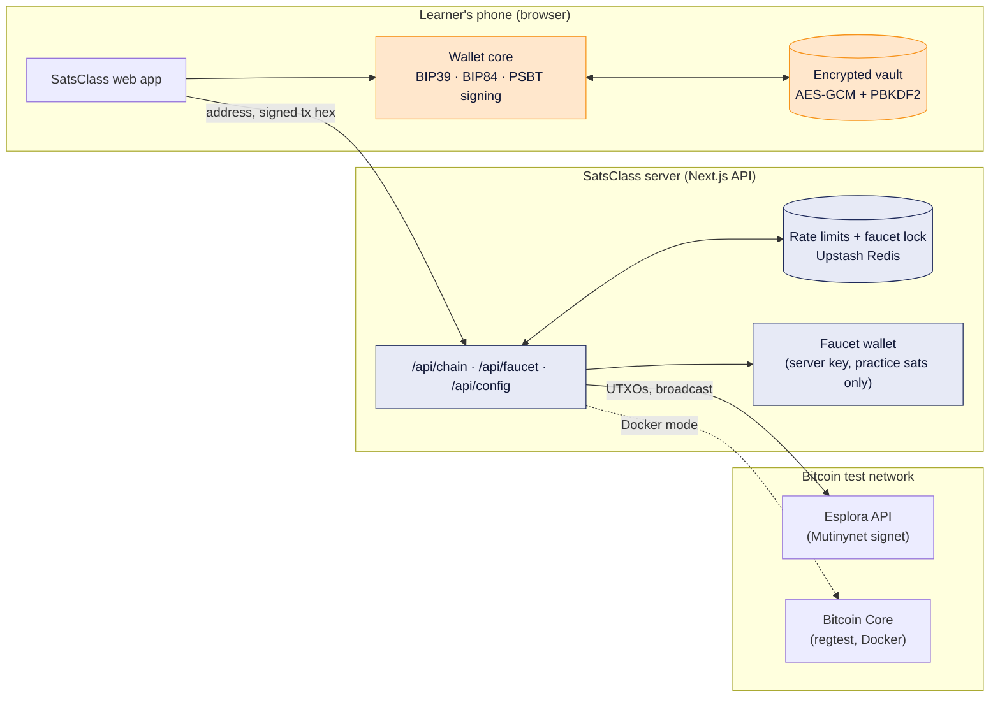
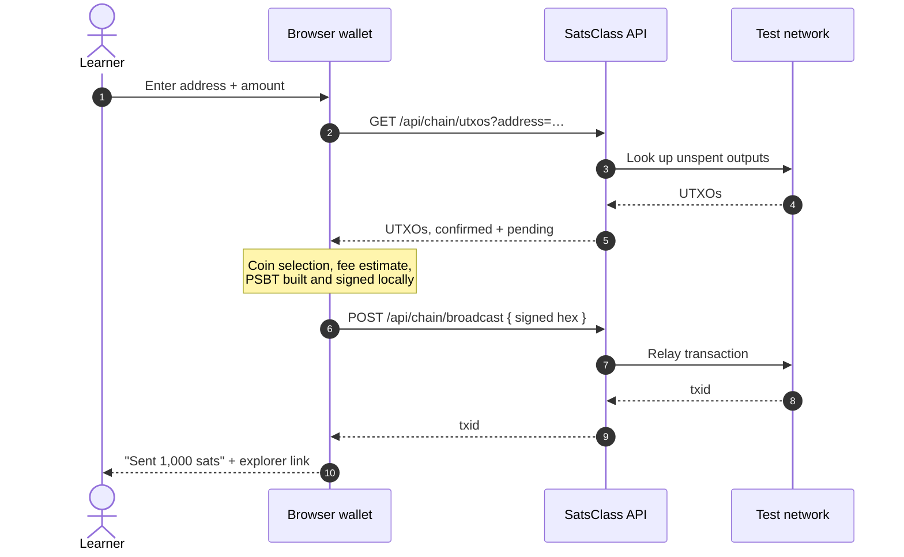
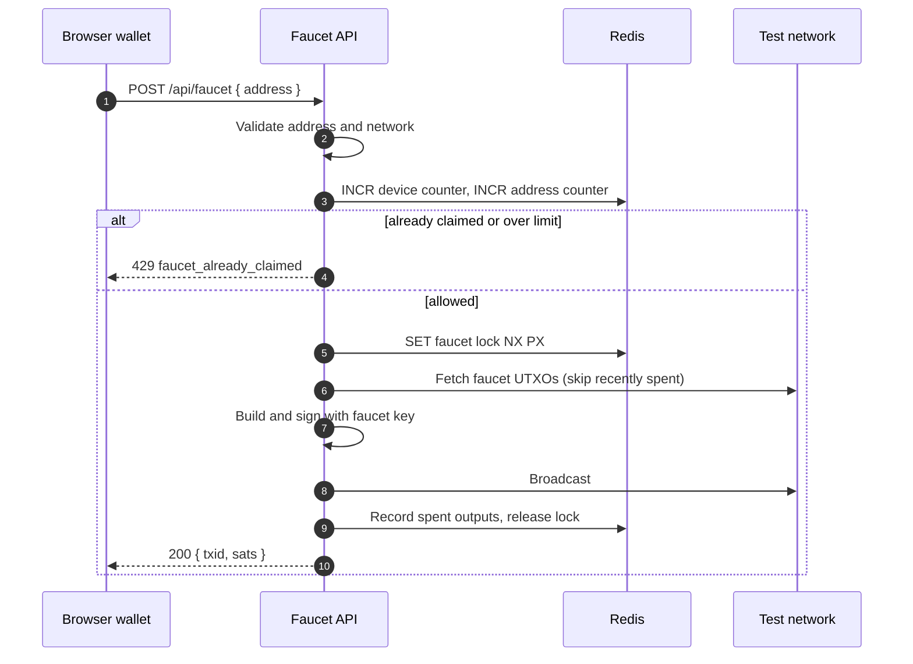

<div align="center">


# SatsClass

**Your first bitcoin, the safe way.**
A real self-custodial wallet on your phone, with practice money, built for Bitcoin classes and meetups.

[](https://satsclass.vercel.app)
[](LICENSE)
[](#networks)
[](https://nextjs.org)
[](app/tsconfig.json)
[](https://github.com/bitcoinjs/bitcoinjs-lib)
[](app/src/lib/i18n.ts)

[Live app](https://satsclass.vercel.app) · [How it works](#how-it-works) · [Run it](#run-it) · [Security](SECURITY.md)

</div>

---

## Why

Most people meet Bitcoin through a custodial exchange app. They never hold a key, never back up a seed, never see a fee. When they finally try self-custody with real money, one mistake costs them.

In classrooms it's worse: a teacher can't ask 30 students to risk real sats, so the lesson stays on the whiteboard.

**SatsClass lets everyone do the real thing with practice money.** Each learner gets a self-custodial wallet in the browser, receives sats from the class faucet, backs up a recovery phrase, and sends a real transaction on a test network. Nothing to install, no account, no personal data.

## Features

| | |
|---|---|
| **Self-custody from minute one** | Keys are generated and used only in the browser. The server never sees a seed or a private key. |
| **Practice money** | Runs on signet (Mutinynet) or a private regtest chain. Sats have no value, so mistakes are free. |
| **Class faucet** | One tap gives each learner 10,000 practice sats. One claim per address, rate-limited per device. |
| **Real transactions** | Native SegWit (BIP84). The browser selects coins, signs, and the server only relays the signed hex. |
| **Encrypted on the phone** | The recovery phrase is stored with AES-GCM, keyed from a 6-digit PIN through PBKDF2 (210,000 rounds). |
| **Built for real classrooms** | Mobile-first, works on slow networks, plain words, English and French. |
| **Classroom mode** | A teacher opens `/teach`, students scan one QR code and pick a nickname. Three missions (get sats, back up, send to a classmate) show up live on the teacher's board. |
| **Ask Sats, the AI tutor** | Answers beginner questions in English or French using the learner's own practice transactions (amounts, fees, confirmations). Pasted recovery phrases are blocked before they reach the model. |
| **One-command setup** | `docker compose up` starts Bitcoin Core, LND, a block miner and the app. |

## How it works

### Architecture



The trust boundary is the browser. Anything that can move a learner's sats (the seed, the keys, the signature) is created and used there. The server handles public data only: addresses, unspent outputs and already-signed transactions.

### Sending sats



### Claiming from the class faucet



The lock and the spent-output list stop two simultaneous claims from spending the same coins. If the faucet fails, the learner's claim is refunded.

## Run it

### Option A: everything local, one command (regtest)

Requirements: Docker with Compose v2.

```bash
git clone https://github.com/thesithunyein/satsclass
cd satsclass
cp .env.example .env          # set BTC_RPC_PASS to a long random string
docker compose up --build
```

Open <http://localhost:3000>, or `http://<your-computer-ip>:3000` from phones on the same Wi-Fi.

| Service | What it does |
|---|---|
| `bitcoind` | Bitcoin Core 29 on regtest, a private chain for the class |
| `seed` | Funds the faucet wallet, then mines a block every 10 seconds |
| `lnd` | LND class node, for Lightning lessons |
| `app` | The web app on port 3000 |

### Option B: hosted on Vercel (signet)

Vercel can't run a Bitcoin node, so the hosted app uses the **Esplora** backend against [Mutinynet](https://mutinynet.com), a public signet with ~30-second blocks.

1. Import the repo in Vercel and set **Root Directory** to `app`.
2. Add **Upstash Redis** from the Vercel Marketplace.
3. Create a faucet wallet (`npm run faucet:new` in `app/`, or create one in the app) and fund it at [faucet.mutinynet.com](https://faucet.mutinynet.com).
4. Set the environment variables below and deploy.

<a id="networks"></a>

### Configuration

| Variable | Docker (regtest) | Vercel (signet) | Notes |
|---|---|---|---|
| `CHAIN_BACKEND` | `core` | `esplora` | Own node vs. public explorer API |
| `BTC_NETWORK` | `regtest` | `signet` | Address format and derivation network |
| `ESPLORA_URL` | | `https://mutinynet.com/api` | Esplora-compatible API |
| `FAUCET_AMOUNT_BTC` | `0.001` | `0.0001` | Per claim, capped at 0.01 |
| `FAUCET_MNEMONIC` | | 12 words | **Secret.** Mark as Sensitive. |
| `KV_REST_API_URL` / `KV_REST_API_TOKEN` | | from Upstash | Shared rate limits and lock |
| `BTC_RPC_URL` / `_USER` / `_PASS` | set in Compose | | Bitcoin Core RPC |
| `EXPLORER_URL` | | optional | Defaults to Mutinynet on Esplora |
| `TUTOR_MODEL` | | optional | Pin an AI Gateway model; otherwise the first allowed model is used |
| `AI_GATEWAY_API_KEY` | | optional | Only needed outside Vercel; on Vercel the project's OIDC token is used |

## Project structure

```
satsclass/
├── app/                      Next.js app (UI + API)
│   ├── src/app/              page, layout, styles, API routes
│   │   └── api/              config · chain/utxos · chain/broadcast · faucet
│   ├── src/lib/              wallet (keys, PSBT), vault (encryption), chain backends,
│   │                         kv (Redis/memory), validation, i18n
│   ├── src/components/       logo, illustration, icon set
│   └── scripts/              faucet wallet generator
├── scripts/seed.sh           regtest funding + block miner
└── docker-compose.yml        bitcoind · lnd · seed · app
```

## Security

Practice networks only. The full threat model, known limits and how to report a vulnerability are in [SECURITY.md](SECURITY.md).

## Roadmap

- [x] Self-custodial browser wallet (create, restore, receive, send)
- [x] Class faucet with shared rate limits
- [x] Regtest Docker stack and hosted signet deployment
- [x] English and French
- [x] Teacher sessions: join a class by QR code
- [x] Guided missions with a seed backup check
- [x] Live class progress board for teachers
- [ ] Lightning mission (pay an invoice)
- [x] Plain-language AI tutor that explains your own transactions
- [ ] More languages, reviewed by native speakers

## Contributing

Contributions are welcome. Read [CONTRIBUTING.md](CONTRIBUTING.md) and our [Code of Conduct](CODE_OF_CONDUCT.md) first.

## License

[MIT](LICENSE) © Sithu Nyein
