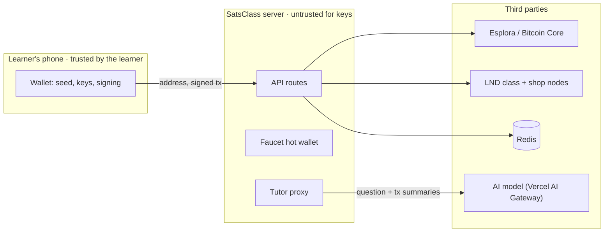

# Threat model

SatsClass is a practice wallet for Bitcoin classes. It runs on signet or regtest; sats have no money value. This document lists what could go wrong, what we do about it, and what risk is left. Reporting: see [SECURITY.md](SECURITY.md).

## System and trust boundaries

**Rule of the design:** anything that can spend a learner's sats (seed, private keys, signatures) is created and used only on the learner's device. The server only ever sees public data: addresses, unspent outputs and already-signed transactions.

## Assets

| Asset | Value | Where |
|---|---|---|
| Learner seed / keys | High to the learner (controls their practice sats, teaches habits) | Browser storage, encrypted |
| Faucet hot wallet | Medium (class can't run without sats) | `FAUCET_MNEMONIC` env var |
| LND macaroons | Medium (class node can pay invoices) | Docker volumes, read-only mounts |
| Teacher token | Low–medium (view the class board) | Teacher's browser; SHA-256 hash on server |
| Class roster | Low (nicknames + practice addresses) | Redis, 48 h TTL |
| RPC / Redis / AI credentials | Medium | Server env only |

## Threats and mitigations (STRIDE)

| # | Threat | Category | Mitigation | Residual risk |
|---|---|---|---|---|
| 1 | Server or network attacker steals learner keys | Information disclosure | Keys never leave the device; no API accepts a seed or key; signing in the browser with `bitcoinjs-lib` | Low |
| 2 | Someone copies the browser storage and brute-forces the PIN | Information disclosure | AES-GCM + PBKDF2-SHA256 (210,000 rounds) | **Medium**: 6 digits = 1,000,000 guesses; accepted only because funds are worthless. Real-money version needs passkeys or a stronger secret |
| 3 | Malicious browser extension reads the unlocked wallet | Information disclosure | Lock button; seed only in memory while unlocked | Medium, inherent to browser wallets |
| 4 | Faucet drained by scripts | Denial of service | One claim per address (24 h) and per learner per class; 10 per device per hour; Redis-backed so limits hold across serverless instances | Low; a determined attacker with many IPs can still drain practice sats |
| 5 | Two simultaneous claims spend the same faucet coins | Tampering | Redis lock (`SET NX PX`) + spent-output list for 10 min | Low; tested with parallel claims |
| 6 | Learner fakes mission completion | Spoofing / repudiation | "Got sats" verified on-chain; "Sent to a classmate" verified by decoding the signed transaction outputs against the roster; "Lightning" recorded only after a real payment | Low; backup check is self-reported by design (3 random words) |
| 7 | Someone else views a class board | Information disclosure | Random UUID teacher token (122 bits), stored as SHA-256, compared in constant time | Low |
| 8 | Class node paid to an outside Lightning node | Tampering / elevation | Only invoices whose destination is the shop node are paid; amount ≤ learner's practice balance; fee limit 50 sat; per-learner lock | Low |
| 9 | App compromise moves the shop's funds | Elevation of privilege | Shop node accessed with **read-only** and **invoice-only** macaroons | Low |
| 10 | Injection via nicknames / class names | Tampering | Server strips control characters and `<>`, caps length; React escapes output | Low |
| 11 | Malformed addresses or transactions | Tampering | Addresses validated against the configured network; raw tx hex checked for format and size before relay | Low |
| 12 | Learner pastes seed into the AI tutor | Information disclosure | Server refuses any message with 8+ BIP39 words in a row before calling the model, and filters it from history | Low; paraphrased seeds could slip through |
| 13 | Prompt injection makes the tutor give harmful advice | Tampering | System prompt limits scope; no tools; tutor can't act, only answer; UI says answers can be wrong | Low |
| 14 | Personal data leaks through logs | Information disclosure | No accounts, emails or phone numbers; logs contain error codes only, never addresses or nicknames | Low |
| 15 | Clickjacking / content sniffing | Tampering | `X-Frame-Options: DENY`, `nosniff`, `no-referrer`, restrictive `Permissions-Policy` | Low |
| 16 | Secrets leaked in the repo | Information disclosure | `.env` git-ignored; GitHub secret scanning on; Vercel secrets marked Sensitive | Low |

## Out of scope

Mainnet use, nation-state attackers, compromised learner devices, and attacks on Mutinynet, Vercel, Upstash or the AI provider themselves.
